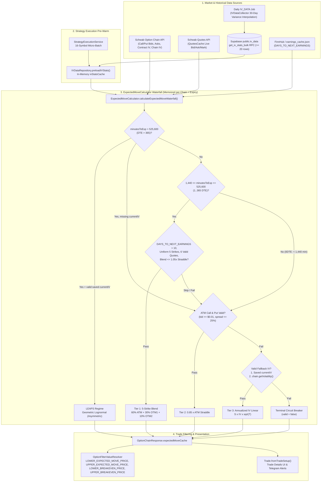

# Implied Volatility (IV) & Expected Move ($1\sigma$) Engine Specification

This document provides an end-to-end technical specification of how **Implied Volatility (IV)** and **$1\sigma$ Expected Move (EM)** price boundaries are ingested, computed, memoized, filtered, and surfaced across the trading bot.

For additional details on historical daily IV collection, 1-year IV Percentile/Rank SQL computation, Historical Volatility (`HV_RANK`), and ATR, see [docs/implied-volatility.md](file:///c:/Projects/trading-bot/docs/implied-volatility.md).

---

## 1. End-to-End Architecture & Data Flow

Across the project, volatility and Expected Move calculations combine **four distinct market data inputs**:
1. **Live Schwab Option Chain Quotes** ([OptionChainCache.java](file:///c:/Projects/trading-bot/src/main/java/com/hemasundar/cache/OptionChainCache.java) / [OptionChainResponse.java](file:///c:/Projects/trading-bot/src/main/java/com/hemasundar/options/models/OptionChainResponse.java)) — per-strike Call/Put bid/ask quotes, per-contract Greeks & IV (`OptionData.volatility`), and chain-wide smoothed underlying IV (`OptionChainResponse.volatility`).
2. **Live Schwab Equity Quotes** ([QuotesCache.java](file:///c:/Projects/trading-bot/src/main/java/com/hemasundar/cache/QuotesCache.java)) — live underlying `bid`, `ask`, `mark`, `lastPrice`, and `closePrice`.
3. **Saved 1-Year Constant-Maturity 30-Day ATM IV** ([IVDataCollector.java](file:///c:/Projects/trading-bot/src/main/java/com/hemasundar/services/IVDataCollector.java) $\rightarrow$ `public.iv_data` $\rightarrow$ [IVDataRepository.java](file:///c:/Projects/trading-bot/src/main/java/com/hemasundar/services/supabase/IVDataRepository.java)) — variance-interpolated $\sigma_{30}$ (`currentIV`), `ivRank`, and `ivPercentile` preloaded per micro-batch via PostgreSQL RPC `get_iv_stats_bulk`.
4. **Corporate Earnings Horizon** ([EarningsDataResolver.java](file:///c:/Projects/trading-bot/src/main/java/com/hemasundar/services/EarningsDataResolver.java)) — `DAYS_TO_NEXT_EARNINGS` from FinnHub / `earnings_cache.json`.



---

## 2. How Implied Volatility (IV) Is Calculated Across the Project

Implied Volatility is not a single number in an options system — different modules require strike-level IV, expiration-interpolated constant-maturity IV, chain-smoothed IV, or direct model-free option midpoints. The table below catalogs **every IV and volatility metric** in the codebase and where each one is used:

| Volatility Metric | Primary Class / Method | Mathematical Basis | Unit / Scale | Where Used in Bot |
| :--- | :--- | :--- | :--- | :--- |
| **1. Constant-Maturity 30-Day ATM IV (`currentIV` / $\sigma_{30}$)** | [IVDataCollector.java](file:///c:/Projects/trading-bot/src/main/java/com/hemasundar/services/IVDataCollector.java)<br>[IVDataRepository.java](file:///c:/Projects/trading-bot/src/main/java/com/hemasundar/services/supabase/IVDataRepository.java) | Dual-expiry bracketing around `30 DTE` ($T_1 \le 30 < T_2$) + CBOE VIX total-variance interpolation across ATM Call/Put IV | Percentage (e.g. `32.5` for `32.5%`); normalized to `0.325` in EM engine | • Daily `public.iv_data` timeseries<br>• `IV_RANK` & `IV_PERCENTILE`<br>• `CURRENT_IV` filter variable<br>• **LEAPS Expected Move** (`DTE > 365`)<br>• **Tier 3 Expected Move** (1st choice) |
| **2. Historical 1Y IV Rank (`IV_RANK`)** | [IVDataRepository.java](file:///c:/Projects/trading-bot/src/main/java/com/hemasundar/services/supabase/IVDataRepository.java) (`get_iv_stats_bulk`) | $\frac{\text{currentIV} - \min_{252}(\text{IV})}{\max_{252}(\text{IV}) - \min_{252}(\text{IV})} \times 100$ (excludes today; requires $\ge 20$ prior rows) | `0.0` – `100.0` | • Symbol-level strategy filter (`IV_RANK`)<br>• Cross-volatility screener<br>• UI Volatility Context (1Y) panel |
| **3. Historical 1Y IV Percentile (`IV_PERCENTILE`)** | [IVDataRepository.java](file:///c:/Projects/trading-bot/src/main/java/com/hemasundar/services/supabase/IVDataRepository.java) (`get_iv_stats_bulk`) | $\frac{\text{Count}(\text{historicalIV} < \text{currentIV})}{M} \times 100$, $20 \le M \le 252$ (excludes today) | `0.0` – `100.0` | • Symbol-level strategy filter (`IV_PERCENTILE`)<br>• Cross-volatility screener<br>• UI Volatility Context (1Y) panel |
| **4. Per-Contract Option Leg IV (`leg.IV`)** | [OptionChainResponse.java](file:///c:/Projects/trading-bot/src/main/java/com/hemasundar/options/models/OptionChainResponse.java) (`OptionData.getVolatility()`) | Broker-computed Black-Scholes / Bjerksund-Stensland implied volatility for a specific `(expiry, strike, CALL/PUT)` | Percentage (normalized from decimal if `< 5` during IV collection) | • Input to `IVDataCollector.extractBlendedATMIV()`<br>• Leg math expressions (`SHORT_LEG.IV`, `LONG_LEG.IV`, `IV`)<br>• Legacy `LegFilter` (`minVolatility`, `maxVolatility`) |
| **5. Chain-Wide Smoothed Underlying IV** | [OptionChainResponse.java](file:///c:/Projects/trading-bot/src/main/java/com/hemasundar/options/models/OptionChainResponse.java) (`chain.getVolatility()`) | Schwab root-level theoretical underlying implied volatility across the option chain | Percentage (e.g. `28.4` $\rightarrow$ `0.284`) | • **Tier 3 Expected Move fallback** when symbol has `< 20` historical rows in Supabase `public.iv_data` |
| **6. Forward Market-Implied Straddle / Strangle Pricing** | [ExpectedMoveCalculator.java](file:///c:/Projects/trading-bot/src/main/java/com/hemasundar/options/expectedmove/ExpectedMoveCalculator.java) | Model-free live option midpoints `(bid + ask) / 2` across ATM and 1st/2nd OTM wings for the exact target expiration | Dollars (`$`) & `%` of spot | • **Tier 1 Expected Move** (`1..365 DTE`)<br>• **Tier 2 Expected Move** (`0DTE` & fallback) |
| **7. Realized 20-Day Historical Volatility & Rank (`HV_RANK`)** | [VolatilityCalculator.java](file:///c:/Projects/trading-bot/src/main/java/com/hemasundar/utils/VolatilityCalculator.java) | Sample std-dev of daily log returns $\ln(P_t / P_{t-1})$ annualized by $\sqrt{252}$, ranked min-max over 1 year | Percentage & `0.0` – `100.0` rank | • Technical screeners (`IV_PERCENTILE > HV_RANK`)<br>• `latest_security_indicators` & `/securities.html` |

### Deep Dive: Constant-Maturity 30-Day ATM IV ($\sigma_{30}$)
Daily scheduled runs (`--app.job.name=IV_DATA` via [IVDataJobService.java](file:///c:/Projects/trading-bot/src/main/java/com/hemasundar/jobs/IVDataJobService.java)) invoke `IVDataCollector.collectIVDataPoint(symbol)`:
1. **Bracketing Expirations**: Selects the near-term cycle $T_1$ ($\max \text{DTE} \le 30$ with $\text{DTE} \ge 7$, relaxing to $\ge 1$ only if no $[7, 30]$ cycle exists) and next-term cycle $T_2$ ($\min \text{DTE} > 30$). If an expiration lands on exactly `30 DTE`, no interpolation is required.
2. **ATM Liquidity & Call/Put Blending**: Evaluates the 5 strikes closest to `underlyingPrice`. Pass 1 requires `bid > 0`, `ask >= bid`, and `volatility > 0`, averaging ATM Call and Put IV:
   $$\sigma_{\text{ATM}} = \frac{\sigma_{\text{call}} + \sigma_{\text{put}}}{2.0}$$
   If one side lacks valid bid liquidity, it uses the valid side; if the market is closed (`bid == 0`), Pass 2 falls back to unvalidated `volatility > 0`.
3. **Total-Variance Interpolation**: Because Brownian variance ($\sigma^2 \cdot T$), not standard deviation ($\sigma$), is additive across time, $\sigma_{30}$ is computed via CBOE VIX-style variance weighting:
   $$w_1 = \frac{\text{DTE}_2 - 30}{\text{DTE}_2 - \text{DTE}_1}, \qquad w_2 = \frac{30 - \text{DTE}_1}{\text{DTE}_2 - \text{DTE}_1}$$
   $$\sigma_{30} = \sqrt{\frac{\sigma_1^2 \cdot \text{DTE}_1 \cdot w_1 + \sigma_2^2 \cdot \text{DTE}_2 \cdot w_2}{30}}$$
4. **Persistence & Bulk Retrieval**: Upserted into `public.iv_data` (`ON CONFLICT (symbol, date) DO UPDATE`). At runtime, `IVDataRepository.getIVStatsForSymbols()` calls `public.get_iv_stats_bulk(p_symbols, p_min_records)` (default `supabase.iv-min-records = 20`). Row 1 (`rn = 1`) supplies `currentIV`, while rows `2..253` (up to 252 trailing trading days, excluding today to prevent self-comparison bias) establish `minIV`, `maxIV`, `ivRank`, and `ivPercentile`.

---

## 3. Expected Move Engine: Phase 1 & Phase 2 Pre-Flight Guardrails

Implemented in [`com.hemasundar.options.expectedmove`](file:///c:/Projects/trading-bot/src/main/java/com/hemasundar/options/expectedmove/ExpectedMoveCalculator.java), the Expected Move calculator converts raw option chain data into validated structures before running any pricing formula.

### 3.1 Underlying Spot Price Resolution (`resolveSpotPrice`)
Stale last-trade prints or wide after-hours equity quotes can shift the ATM strike anchor and corrupt intrinsic-parity checks. `resolveSpotPrice(chain, quoteData)` evaluates sources in strict priority order:
1. **`QuotesCache` Live Equity Midpoint**: `(bid + ask) / 2.0`, accepted only when `bid > 0`, `ask >= bid`, and relative equity spread `(ask - bid) / mid <= 5%` (`MAX_EQUITY_RELATIVE_SPREAD = 0.05`).
2. **`QuotesCache` Fallbacks**: `quote.mark` ($> 0$) $\rightarrow$ `quote.lastPrice` ($> 0$) $\rightarrow$ `quote.closePrice` ($> 0$).
3. **`OptionChainResponse.underlying` Map**: Embedded `bid`/`ask` midpoint (with the same `<= 5%` spread cap) $\rightarrow$ `mark` $\rightarrow$ `last` $\rightarrow$ `close`.
4. **Chain Root Price**: `chain.getUnderlyingPrice()` ($> 0$).
5. If all sources fail ($\le 0$, `NaN`, or `Infinite`), the engine immediately trips the **Terminal Circuit Breaker**.

### 3.2 Exact Settlement Horizon (`computeMinutesToExp`)
Using integer calendar `DTE` treats a 9:35 AM ET `0DTE` scan (`385` minutes left) identically to a 3:55 PM ET scan (`5` minutes left) or `DTE = 0` as zero time remaining. Instead, `computeMinutesToExp(chain, expiryDate)` computes exact minutes until standard US equity options settlement (**`16:00 America/New_York`** on `expiryDate`):
$$\text{minutesToExp} = \frac{\text{Duration.between}(\text{now}_{\text{ET}},\ \text{expiryDate at 16:00 ET}).\text{toSeconds}()}{60.0}$$
- **Day constant**: `MINUTES_PER_DAY = 1,440.0`
- **Year constant**: `MINUTES_PER_YEAR = 525,600.0` ($365 \times 1{,}440$)
- If `minutesToExp <= 0.0`, expiration has passed and the **Terminal Circuit Breaker** trips immediately.

### 3.3 Strike Pairing (`buildStrikeRows`)
`buildStrikeRows(chain, expiryDate)` pairs Call and Put contracts for `expiryDate` into an ascending list of immutable [`StrikeRow`](file:///c:/Projects/trading-bot/src/main/java/com/hemasundar/options/expectedmove/StrikeRow.java) records (`strike`, `call`, `put`). Strikes are indexed in a `TreeMap<Long, OptionData>` keyed by `Math.round(strikePrice * 10_000.0)` so IEEE-754 floating-point representations (e.g. `100.0` vs `100.00000001`) always pair cleanly.

### 3.4 Individual Contract Quote Hygiene (`isValidContract`)
Every option leg sampled in Tier 1 or Tier 2 must pass four checks:
1. **Two-Sided Market**: `contract != null`, `bid > 0`, and `ask >= bid`.
2. **Minimum Bid Floor (Penny-Tick Guard)**:
   - **Tier 1**: `bid >= $0.05` (`TIER_1_MIN_BID`) — prevents `$0.00 x $0.05` exchange minimum tick floors on OTM wings from artificially inflating the blend.
   - **Tier 2**: `bid >= $0.01` (`TIER_2_MIN_BID`).
3. **Relative Bid-Ask Spread Cap**:
   $$\frac{\text{ask} - \text{bid}}{\text{mid}} \le \begin{cases} 0.15 \ (15\%), & \text{Tier 1} \\ 0.25 \ (25\%), & \text{Tier 2} \end{cases}$$
   where $\text{mid} = \frac{\text{bid} + \text{ask}}{2.0}$.
4. **Intrinsic Value Parity (`$0.05` Tolerance)**:
   $$\text{mid} + 0.05 \ge \text{intrinsic}, \qquad \text{intrinsic} = \begin{cases} \max(0,\ S - K), & \text{Call} \\ \max(0,\ K - S), & \text{Put} \end{cases}$$
   Rejects stale deep-ITM quotes that lag behind a fast underlying move.

### 3.5 ATM Strike Selection & Midpoint Tie-Breaker (`findAtmIndex`)
`findAtmIndex(rows, spotPrice)` finds the strike minimizing $|K - S|$. When `spotPrice` sits dead-center between two strikes (e.g. $S = 102.50$ between `$100` and `$105`, within `SPOT_TIE_TOLERANCE = 0.001`), it breaks the tie deterministically by choosing the strike with the **tighter combined Call + Put dollar spread**:
$$\text{combinedSpread}(K) = (\text{callAsk} - \text{callBid}) + (\text{putAsk} - \text{putBid})$$

---

## 4. Phase 3: The 3-Tier Waterfall + LEAPS Formulas

`calculateExpectedMoveWaterfall(...)` evaluates five mutually ordered branches and returns an immutable [`ExpectedMoveResult`](file:///c:/Projects/trading-bot/src/main/java/com/hemasundar/options/expectedmove/ExpectedMoveResult.java) tagged with [`ExpectedMoveTier`](file:///c:/Projects/trading-bot/src/main/java/com/hemasundar/options/expectedmove/ExpectedMoveTier.java).

### Branch A — LEAPS Regime (`DTE > 365`, `minutesToExp > 525,600`)
- **Tier Enum**: `ExpectedMoveTier.LEAPS_LOGNORMAL` (`"LEAPS"`)
- **Why Standard Straddles Fail on Multi-Year Expiries**:
  1. **Risk-Free Carry Distortion**: Under Black-Scholes ($C - P = S - K e^{-rT}$), a 2–3 year ATM Call embeds substantial risk-free interest carry ($r > 0$) unrelated to volatility, overstating straddle-based Expected Move.
  2. **Negative Price Artifact**: On high-IV growth stocks ($\text{IV} = 65\%$, $T = 2.5$ years), linear $\text{IV}\sqrt{T} \approx 102.8\%$, causing $S - \text{EM}$ to project a negative stock price.
- **Eligibility**: `minutesToExp > 525,600` **AND** `savedCurrentIvPct` from `IVDataRepository.getCurrentIV(symbol)` (`>= 20` historical records) normalizes to a valid decimal $\text{IV} \in (0, 10.0]$.
- **Asymmetric Geometric Lognormal Formula**:
  $$T = \frac{\text{minutesToExp}}{525{,}600}, \qquad \sigma\sqrt{T} = \text{IV} \times \sqrt{T}$$
  $$\text{Upper Bound} = S \cdot e^{+\sigma\sqrt{T}}, \qquad \text{Lower Bound} = S \cdot e^{-\sigma\sqrt{T}}$$
  $$\text{Upside Move} = \text{Upper Bound} - S, \qquad \text{Downside Move} = S - \text{Lower Bound}$$
- **Fallback**: If `savedCurrentIvPct` is `null` (`< 20` historical rows in Supabase) or invalid, LEAPS skips Tier 1 and falls directly to **Tier 2** $\rightarrow$ **Tier 3**.
- **Worked Example**:
  - Suppose $S = \$200.00$, `DTE = 730` ($T = 2.0$ years), `currentIV = 40.0%` ($\text{IV} = 0.40$):
  - $\sigma\sqrt{T} = 0.40 \times \sqrt{2.0} = 0.565685$
  - $\text{Upper Bound} = 200 \times e^{+0.565685} = \$352.13$ ($\text{Upside Move} = +\$152.13$, `+76.07%`)
  - $\text{Lower Bound} = 200 \times e^{-0.565685} = \$113.59$ ($\text{Downside Move} = -\$86.41$, `-43.20%`)

---

### Branch B — Tier 1 (`1 <= DTE <= 365`, `1,440 <= minutesToExp <= 525,600`): Institutional 5-Strike Blend (`60% / 30% / 10%`)
- **Tier Enum**: `ExpectedMoveTier.TIER_1_FIVE_STRIKE_BLEND` (`"Tier 1"`)
- **Purpose**: Samples **6 liquid contracts across 5 strikes** (`atmIdx - 2` through `atmIdx + 2`), capturing real-world OTM put/call skew and fat-tail wing pricing while canceling intrinsic distortion when $S$ sits between strikes.
- **Strict Pre-Conditions (All 6 Required)**:
  1. **Earnings Guard**: `daysToNextEarnings == null || daysToNextEarnings > 10.0` (`TIER_1_MAX_EARNINGS_DAYS = 10.0`, applied uniformly across `1..365 DTE` so binary event term-structure kinks route to Tier 2).
  2. **Chain Depth**: `atmIdx >= 2` and `atmIdx + 2 < strikeRows.size()` (at least 2 OTM strikes on both sides of ATM).
  3. **Uniform Strike Spacing**: Every adjacent step across `atmIdx - 2 .. atmIdx + 2` matches within `STRIKE_SPACING_TOLERANCE = 0.001` (prevents mixed `$1` / `$2.50` / `$5` strike grids from skewing the `30%` and `10%` wing weights).
  4. **6-Contract Quote Hygiene**: All 6 contracts (`ATM Call`, `ATM Put`, `1st OTM Call` at `atmIdx + 1`, `1st OTM Put` at `atmIdx - 1`, `2nd OTM Call` at `atmIdx + 2`, `2nd OTM Put` at `atmIdx - 2`) pass `isValidContract` with `minBid = $0.05` and `maxSpreadPct = 15%`.
  5. **Formula**:
     $$\text{ATM Straddle} = C_{0,\text{mid}} + P_{0,\text{mid}}$$
     $$\text{1st OTM Strangle} = C_{+1,\text{mid}} + P_{-1,\text{mid}}$$
     $$\text{2nd OTM Strangle} = C_{+2,\text{mid}} + P_{-2,\text{mid}}$$
     $$\text{EM} = 0.60 \times (\text{ATM Straddle}) + 0.30 \times (\text{1st OTM Strangle}) + 0.10 \times (\text{2nd OTM Strangle})$$
  6. **Sanity Cap**: $\text{EM} \le 1.05 \times \text{ATM Straddle}$ (`TIER_1_SANITY_CAP_MULTIPLIER = 1.05`) — rejects corrupted outer-wing quotes whose strangle price exceeds the ATM straddle.
- **Symmetric Bounds**:
  $$\text{Upper Bound} = S + \text{EM}, \qquad \text{Lower Bound} = \max(0.0,\ S - \text{EM})$$
  (`upsideMove == downsideMove == EM` whenever $S \ge \text{EM}$.)
- **Worked Example**:
  - Suppose `SPY` trades at $S = \$500.00$, `35 DTE`, `DAYS_TO_NEXT_EARNINGS = 999999`, uniform `$5` strikes (`$490, $495, $500, $505, $510`):
  - `ATM Straddle` (`$500 C/P` mids `$12.80 + $12.60`) $= \$25.40$
  - `1st OTM Strangle` (`$505 C` mid `$10.10` + `$495 P` mid `$10.50`) $= \$20.60$
  - `2nd OTM Strangle` (`$510 C` mid `$7.80` + `$490 P` mid `$8.60`) $= \$16.40$
  - $\text{EM} = 0.60(25.40) + 0.30(20.60) + 0.10(16.40) = 15.24 + 6.18 + 1.64 = \mathbf{\$23.06}$ (`<= 1.05 * 25.40 = $26.67` $\checkmark$)
  - $\text{Lower Bound} = \$476.94$, $\text{Upper Bound} = \$523.06$ (`±$23.06 / ±4.61%`).

---

### Branch C — Tier 2 (`0DTE` Primary or Fallback): `0.85 × ATM Straddle`
- **Tier Enum**: `ExpectedMoveTier.TIER_2_ATM_STRADDLE` (`"Tier 2"`)
- **Mathematical Basis**: Under a zero-drift normal approximation, $\text{ATM Straddle} \approx \sqrt{\frac{2}{\pi}} \sigma S \sqrt{T} \approx 0.7979 \cdot \text{EM}_{1\sigma}$ (each ATM leg is $\approx 0.3989 \sigma S \sqrt{T}$, so the straddle is $\approx 0.7979 \times 2$ when including skew/kurtosis). Empirically across equity options with fat tails and intraday pin dynamics, scaling the ATM straddle by **$0.85$** closely approximates the realized $1\sigma$ (~68.2%) boundary using only the two most liquid contracts on the board.
- **When It Runs**:
  1. **Primary Engine for `0DTE`**: Whenever `minutesToExp < 1,440` (`< 24` hours to 4:00 PM ET settlement), avoiding artificial `$0.05` tick-size floors on decaying OTM wings.
  2. **Automatic Fallback from Tier 1 or LEAPS**: Whenever **any** condition causes Tier 1 (or LEAPS) to be skipped — including `DAYS_TO_NEXT_EARNINGS <= 10`, non-uniform strike spacing, chain boundary proximity, wide wing spreads (`> 15%`), or `< 20` historical IV records for LEAPS. *(Note: Earnings within 10 days is NOT required for Tier 2 — Tier 2 runs whenever its own ATM quote hygiene passes.)*
- **Eligibility**: Both `ATM Call` and `ATM Put` pass `isValidContract` with `minBid = $0.01` and `maxSpreadPct = 25%`.
- **Formula & Symmetric Bounds**:
  $$\text{EM} = 0.85 \times \big(C_{0,\text{mid}} + P_{0,\text{mid}}\big)$$
  $$\text{Upper Bound} = S + \text{EM}, \qquad \text{Lower Bound} = \max(0.0,\ S - \text{EM})$$

---

### Branch D — Tier 3 (Quote-Degraded Fallback): Annualized IV Linear Model
- **Tier Enum**: `ExpectedMoveTier.TIER_3_IV_LINEAR` (`"Tier 3"`)
- **When It Runs**: Pre-market / after-hours / weekend scans (when option `bid` quotes reset to `$0.00`), brief exchange quote halts, or thinly traded chains where even the ATM straddle spread exceeds `25%`.
- **Strict IV Fallback Priority**:
  1. **Primary**: Saved 30-day ATM `currentIV` from `IVDataRepository.getCurrentIV(symbol)` (requires `>= 20` historical rows in Supabase `public.iv_data`), normalized via `ivPercent / 100.0`.
  2. **Secondary Fallback**: Schwab's chain-wide smoothed underlying `chain.getVolatility()`, normalized via `ivPercent / 100.0` when `IVDataRepository` has `< 20` historical records.
- **Formula & Symmetric Bounds**:
  $$\text{EM} = S \times \text{IV} \times \sqrt{\frac{\max(\text{minutesToExp},\ 1.0)}{525{,}600}}$$
  $$\text{Upper Bound} = S + \text{EM}, \qquad \text{Lower Bound} = \max(0.0,\ S - \text{EM})$$

---

### Branch E — Terminal Circuit Breaker
- **Tier Enum**: `ExpectedMoveTier.CIRCUIT_BREAKER` (`"Unavailable"`)
- **Trigger**: Spot price invalid, expiration already passed (`minutesToExp <= 0`), empty strike map, or Tier 1/2 quotes failed hygiene AND both `IVDataRepository` `currentIV` and `chain.getVolatility()` are missing/corrupted.
- **Behavior**: Returns `ExpectedMoveResult.circuitBreaker(spotPrice, reason)` with `valid = false`.
  - Strategies **without** Expected Move filter conditions continue executing unaffected; Trade Details simply omits the `EM (1σ)` line.
  - Strategies **with** an active `*_EXPECTED_MOVE*` filter condition evaluate `OptionFilterValueResolver.resolveTradeValue(...) -> null`, causing `MathExpression.evaluate(...)` to return `false` (**fail-closed** safety).

---

### Master Constants & Guardrails Reference

| Constant | Value | Role |
| :--- | :--- | :--- |
| `MINUTES_PER_DAY` | `1,440.0` | Boundary between `0DTE` (`< 1,440`) and Tier 1 (`>= 1,440`) |
| `MINUTES_PER_YEAR` | `525,600.0` | Annualization denominator & LEAPS boundary (`> 525,600`) |
| `MAX_EQUITY_RELATIVE_SPREAD` | `0.05` (`5%`) | Max `(ask - bid) / mid` to trust live equity midpoint as `spotPrice` |
| `SPOT_TIE_TOLERANCE` | `0.001` | Distance tolerance for triggering combined-spread ATM tie-breaker |
| `STRIKE_SPACING_TOLERANCE` | `0.001` | Maximum step deviation across the 5 Tier 1 strikes |
| `TIER_1_MAX_EARNINGS_DAYS` | `10.0` | Tier 1 requires `DAYS_TO_NEXT_EARNINGS > 10` |
| `TIER_1_MIN_BID` | `$0.05` | Minimum bid across all 6 Tier 1 contracts |
| `TIER_1_MAX_SPREAD_PCT` | `0.15` (`15%`) | Maximum relative spread `(ask - bid) / mid` in Tier 1 |
| `TIER_1_SANITY_CAP_MULTIPLIER` | `1.05` | Caps Tier 1 `blendedEm <= 1.05 * atmStraddle` |
| `TIER_2_MIN_BID` | `$0.01` | Minimum bid on ATM Call and ATM Put in Tier 2 |
| `TIER_2_MAX_SPREAD_PCT` | `0.25` (`25%`) | Maximum relative spread `(ask - bid) / mid` in Tier 2 |
| `TIER_2_STRADDLE_FACTOR` | `0.85` | Straddle multiplier (`0.85 * ATM Straddle`) in Tier 2 |
| `INTRINSIC_PARITY_TOLERANCE` | `$0.05` | Allows `mid + $0.05 >= intrinsicValue` before rejecting stale ITM quotes |
| `MAX_VALID_DECIMAL_IV` | `10.0` (`1000%`) | Upper sanity ceiling in `normalizeIvToDecimal` |

---

## 5. Strategy Breakeven Normalization & Filter Integration

### 5.1 Unified Filter Expression Variables
[`OptionFilterValueResolver.java`](file:///c:/Projects/trading-bot/src/main/java/com/hemasundar/options/models/OptionFilterValueResolver.java) exposes six Expected Move variables and two polymorphic breakeven variables inside `filter.conditions`:

| Variable | Unit | Resolved Value on `TradeSetup` |
| :--- | :--- | :--- |
| `LOWER_EXPECTED_MOVE_PRICE` | `$` | `expectedMove.getLowerBound()` ($1\sigma$ lower price boundary) |
| `UPPER_EXPECTED_MOVE_PRICE` | `$` | `expectedMove.getUpperBound()` ($1\sigma$ upper price boundary) |
| `DOWNSIDE_EXPECTED_MOVE_DOLLARS` | `$` | `expectedMove.getDownsideMove()` ($S - \text{LOWER\_EXPECTED\_MOVE\_PRICE}$) |
| `UPSIDE_EXPECTED_MOVE_DOLLARS` | `$` | `expectedMove.getUpsideMove()` ($\text{UPPER\_EXPECTED\_MOVE\_PRICE} - S$) |
| `DOWNSIDE_EXPECTED_MOVE_PCT` | `%` | `expectedMove.getDownsideMovePct()` ($\frac{\text{DOWNSIDE\_EXPECTED\_MOVE\_DOLLARS}}{S} \times 100$) |
| `UPSIDE_EXPECTED_MOVE_PCT` | `%` | `expectedMove.getUpsideMovePct()` ($\frac{\text{UPSIDE\_EXPECTED\_MOVE\_DOLLARS}}{S} \times 100$) |
| `LOWER_BREAKEVEN_PRICE` | `$` | `trade.getEffectiveLowerBreakEvenPrice()` (strategy-aware downside breakeven) |
| `UPPER_BREAKEVEN_PRICE` | `$` | `trade.getEffectiveUpperBreakEvenPrice()` (strategy-aware upside breakeven) |

Cross-scope expressions comparing an individual option leg against an Expected Move boundary (such as `SHORT_LEG.STRIKE_PRICE <= LOWER_EXPECTED_MOVE_PRICE` or `CALL_SHORT.STRIKE_PRICE >= UPPER_EXPECTED_MOVE_PRICE`) are also supported directly in `filter.conditions`: [`FilterParser.java`](file:///c:/Projects/trading-bot/src/main/java/com/hemasundar/options/models/FilterParser.java) and [`AbstractTradingStrategy.java`](file:///c:/Projects/trading-bot/src/main/java/com/hemasundar/options/strategies/AbstractTradingStrategy.java) detect that the right-hand variable is a trade-level Expected Move metric rather than a leg-only literal and route evaluation to `FilterPipeline<TradeSetup>`.

### 5.2 Polymorphic Breakeven Mapping Across All 8 Strategies
Historically, single-breakeven upside strategies (`CallCreditSpread`, `LongCallLeap`, `ZebraTrade`) store their upside breakeven in `breakEvenPrice` (leaving `upperBreakEvenPrice == 0`). `LOWER_BREAKEVEN_PRICE` and `UPPER_BREAKEVEN_PRICE` normalize directional semantics across all 8 strategy models:

| Strategy Model | `LOWER_BREAKEVEN_PRICE` (`getEffectiveLowerBreakEvenPrice()`) | `UPPER_BREAKEVEN_PRICE` (`getEffectiveUpperBreakEvenPrice()`) |
| :--- | :--- | :--- |
| [PutCreditSpread.java](file:///c:/Projects/trading-bot/src/main/java/com/hemasundar/options/models/PutCreditSpread.java) | `shortPutStrike - netCreditPerShare` | `null` |
| [ShortPut.java](file:///c:/Projects/trading-bot/src/main/java/com/hemasundar/options/models/ShortPut.java) | `shortPutStrike - premiumPerShare` | `null` |
| [CallCreditSpread.java](file:///c:/Projects/trading-bot/src/main/java/com/hemasundar/options/models/CallCreditSpread.java) | `null` | `shortCallStrike + netCreditPerShare` |
| [IronCondor.java](file:///c:/Projects/trading-bot/src/main/java/com/hemasundar/options/models/IronCondor.java) | `putShortStrike - totalNetCreditPerShare` | `callShortStrike + totalNetCreditPerShare` |
| [ShortStrangle.java](file:///c:/Projects/trading-bot/src/main/java/com/hemasundar/options/models/ShortStrangle.java) | `putStrike - totalCreditPerShare` | `callStrike + totalCreditPerShare` |
| [BrokenWingButterfly.java](file:///c:/Projects/trading-bot/src/main/java/com/hemasundar/options/models/BrokenWingButterfly.java) | `leg1Strike + netDebitPerShare` | `leg3Strike - maxLossUpsidePerShare` |
| [LongCallLeap.java](file:///c:/Projects/trading-bot/src/main/java/com/hemasundar/options/models/LongCallLeap.java) | `null` | `callStrike + optionPrice` |
| [ZebraTrade.java](file:///c:/Projects/trading-bot/src/main/java/com/hemasundar/options/models/ZebraTrade.java) | `null` | `breakEvenPrice` |

### 5.3 Safe Credit Strategy Filter Rules (`strategies-config.yml`)
For short-premium credit strategies that profit when the stock stays quiet, keeping the $\pm 1\sigma$ Expected Move **inside** the trade's breakeven boundaries guarantees the trade remains profitable even if the underlying moves a full 1 standard deviation by expiration:

```text
  $471.00                   $476.94          $500.00           $523.06                $529.00
─────●─────────────────────────┼────────────────●─────────────────┼──────────────────────●─────► Price ($)
LOWER_BREAKEVEN_PRICE  LOWER_EXPECTED_MOVE_PRICE  Spot (S)  UPPER_EXPECTED_MOVE_PRICE  UPPER_BREAKEVEN_PRICE
                               ◄──────── ±1σ Expected Move ───────►
  ◄────────────────────────────── Profitable Zone at Expiration ───────────────────────────►
```

Configured in [`strategies-config.yml`](file:///c:/Projects/trading-bot/src/main/resources/strategies-config.yml):
- **Iron Condors**:
  ```yaml
  conditions:
    - "LOWER_BREAKEVEN_PRICE <= LOWER_EXPECTED_MOVE_PRICE"
    - "UPPER_BREAKEVEN_PRICE >= UPPER_EXPECTED_MOVE_PRICE"
  ```
- **Put Credit Spreads (PCS)** & **OTM Short Puts**:
  ```yaml
  conditions:
    - "LOWER_BREAKEVEN_PRICE <= LOWER_EXPECTED_MOVE_PRICE"
  ```
- **Call Credit Spreads (CCS)**:
  ```yaml
  conditions:
    - "UPPER_BREAKEVEN_PRICE >= UPPER_EXPECTED_MOVE_PRICE"
  ```
- Arithmetic scaling and offsets work out of the box (e.g. `LOWER_BREAKEVEN_PRICE <= LOWER_EXPECTED_MOVE_PRICE * 98%`, `UPPER_BREAKEVEN_PRICE >= CURRENT_PRICE + UPSIDE_EXPECTED_MOVE_DOLLARS * 125%`, or `UPPER_BREAKEVEN_PRICE <= UPPER_EXPECTED_MOVE_PRICE` for debit strategies requiring reachable breakevens inside $+1\sigma$).

### 5.4 Fail-Open vs. Fail-Closed Semantics Comparison
| Filter Family | When Underlying Data Is Missing | Behavior | Rationale |
| :--- | :--- | :--- | :--- |
| **`IV_RANK`, `IV_PERCENTILE`, `HV_RANK`** | Newly listed ticker or `< 20` historical rows in `public.iv_data` | **Fail-Open** (passes symbol) | Prevents newly added watchlist symbols from being silently blocked while daily IV history accumulates. |
| **`LOWER_EXPECTED_MOVE_PRICE`, `UPPER_EXPECTED_MOVE_PRICE`, `*_EXPECTED_MOVE*`** | All 4 Expected Move branches fail (`CIRCUIT_BREAKER`) | **Fail-Closed** (`resolveTradeValue` returns `null` $\rightarrow$ `false`) | Tier 3 already falls back from `IVDataRepository` to `chain.getVolatility()`. Reaching `CIRCUIT_BREAKER` indicates severely corrupted or halted chain data where safety bounds cannot be verified. |

---

## 6. Caching, Batch Pre-Warming & Runtime Complexity

1. **Zero Extra Network Calls During Waterfall Execution**:
   - In [`StrategyExecutionService.java`](file:///c:/Projects/trading-bot/src/main/java/com/hemasundar/services/StrategyExecutionService.java), each 16-symbol micro-batch pre-populates:
     - `OptionChainCache` (single Schwab option chain fetch per unique symbol)
     - `QuotesCache` (single bulk Schwab quotes request per micro-batch)
     - `IVDataRepository.ivStatsCache` via `supabaseService.preloadIVStats(microBatch)` (single PostgREST RPC `get_iv_stats_bulk` call per micro-batch, including negative-cache entries for `< 20`-row symbols)
     - `earnings_cache.json` via upfront `finnHubAPIs.getEarningsByTicker(...)` in `AbstractTradingStrategy.findTrades()`
2. **Per-`(Symbol, ExpiryDate)` Memoization**:
   - [`OptionChainResponse.java`](file:///c:/Projects/trading-bot/src/main/java/com/hemasundar/options/models/OptionChainResponse.java) holds a `@JsonIgnore` transient `ConcurrentHashMap<String, ExpectedMoveResult> expectedMoveCache` accessed via `computeIfAbsentExpectedMove(expiryDate, loader)`.
   - Because Expected Move is a property of `(symbol, expiryDate)` rather than individual strike combinations, even if an Iron Condor evaluates 1,000 candidate 4-leg spreads on `(SPY, 2026-12-18)` across 3 different strategies sharing `OptionChainCache`, `ExpectedMoveCalculator` executes **at most once** for `(SPY, 2026-12-18)` (~microseconds in memory).

---

## 7. DTO Serialization, UI Trade Details & Telegram Formatting

When a surviving `TradeSetup` is converted via [`Trade.fromTradeSetup(setup, symbol)`](file:///c:/Projects/trading-bot/src/main/java/com/hemasundar/dto/Trade.java):
1. **Structured JSON Fields on `Trade`**:
   - `expectedMoveLowerPrice`, `expectedMoveUpperPrice`, `expectedMoveUpsideDollars`, `expectedMoveDownsideDollars`, `expectedMoveUpsidePct`, `expectedMoveDownsidePct`, `expectedMoveTier` (`"Tier 1"`, `"Tier 2"`, `"Tier 3"`, `"LEAPS"`), and `expectedMoveReason` (diagnostic tier selection / fallback explanation).
2. **`tradeDetails` String & Telegram Notifications**:
   - **Symmetric Tiers (`Tier 1`, `Tier 2`, `Tier 3`)** (where $|\text{upsideMove} - \text{downsideMove}| < 0.01$):
     ```text
     EM (1σ, Tier 1): $476.94 – $523.06 (±$23.06 / ±4.61%)
     EM tier selection notes: Tier 1 5-strike blend (60/30/10)
     ```
   - **Asymmetric Regime (`LEAPS` or `$0.00`-floored downside)**:
     ```text
     EM (1σ, LEAPS): $113.59 – $352.13 (+$152.13 / +76.07%, -$86.41 / -43.20%)
     EM tier selection notes: LEAPS geometric lognormal model (DTE > 365, saved currentIV 40.0%)
     ```
3. **Interactive Row-Click Trade Details Panel (`dashboard.js`)**:
   - Clicking any trade row on `/index.html` or `/execute.html` renders the formatted `EM (1σ, <Tier>)` range and `EM tier selection notes: <reason>` inside the expandable **Trade Details** panel via `formatExpectedMoveDetail(trade)` (avoiding duplicate lines when `trade.tradeDetails` already embeds the `EM (` / `EM tier selection notes:` lines, while gracefully synthesizing them from structured `expectedMove*` JSON fields for persisted records). No extra column is added to the main trade summary table so horizontal table density remains clean.
4. **Custom Execute Strategy Condition Builder (`/execute.html`)**:
   - [`custom-execute.js`](file:///c:/Projects/trading-bot/src/main/resources/static/js/custom-execute.js) includes `LOWER_BREAKEVEN_PRICE`, `UPPER_BREAKEVEN_PRICE`, `LOWER_EXPECTED_MOVE_PRICE`, `UPPER_EXPECTED_MOVE_PRICE`, `DOWNSIDE_EXPECTED_MOVE_DOLLARS`, `UPSIDE_EXPECTED_MOVE_DOLLARS`, `DOWNSIDE_EXPECTED_MOVE_PCT`, and `UPSIDE_EXPECTED_MOVE_PCT` in `TRADE_VARIABLES`, backed by interactive speech-balloon tooltips in [`filter-descriptions.json`](file:///c:/Projects/trading-bot/src/main/resources/static/filter-descriptions.json).
